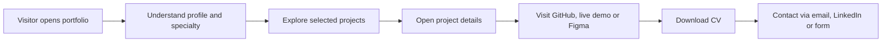
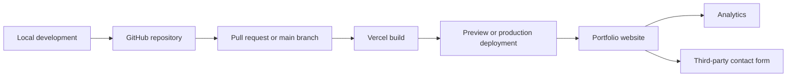

# PRD — Personal Portfolio Website: Guntur Listyo Prabowo

## 1. Ringkasan Eksekutif

Personal Portfolio Website untuk Guntur Listyo Prabowo adalah website portofolio profesional satu halaman yang memperkenalkan identitas, kemampuan, pengalaman, dan proyek dalam satu tempat.

Website ini memadukan personal branding, showcase proyek, dan interaksi visual secara seimbang. Pengunjung harus bisa memahami kemampuan Guntur dengan cepat, melihat bukti hasil pekerjaannya, serta menghubunginya untuk peluang kerja atau proyek freelance.

Pengalaman visual mengusung gaya modern minimalis, mendukung light mode dan dark mode, serta menggunakan animasi halus tanpa mengorbankan aksesibilitas dan performa.

Target awal adalah meluncurkan MVP dalam **1 minggu**, kemudian mengembangkan fitur tambahan secara bertahap berdasarkan kesiapan konten dan hasil penggunaan.

---

## 2. Visi dan Tujuan Produk

### Visi

Membangun identitas profesional digital yang meyakinkan, mudah diakses, dan memiliki karakter visual tersendiri untuk menampilkan kemampuan Guntur sebagai Frontend/Web Developer dan UI/UX Designer.

### Tujuan Bisnis dan Produk

1. **Personal branding**: membangun identitas profesional yang konsisten.
2. **Peluang karier**: membantu recruiter dan hiring manager mengevaluasi kemampuan Guntur.
3. **Akuisisi klien**: memudahkan calon klien menemukan layanan dan menghubungi Guntur.
4. **Showcase proyek**: menampilkan hasil, kontribusi, teknologi, dan bukti pekerjaan.
5. **Reputasi profesional**: membuka peluang kolaborasi dengan developer, designer, dan komunitas teknologi.

### Indikator Keberhasilan

- Pengunjung dapat memahami profil dan spesialisasi Guntur dengan cepat.
- Proyek unggulan dapat ditemukan dan dievaluasi dengan mudah.
- Tautan demo, repository, dan desain berfungsi dengan benar.
- Pengunjung dapat mengunduh CV dan menghubungi Guntur tanpa hambatan.
- Website tampil baik pada desktop, tablet, dan perangkat mobile.
- Website memiliki performa, aksesibilitas, dan SEO dasar yang baik.

---

## 3. Target Pengguna

### 3.1 Recruiter dan HR Teknologi
- **Kebutuhan utama:** menilai profil kandidat, skill, pengalaman, dan proyek dengan cepat.
- **Informasi penting:** headline profesional, skill, pengalaman, CV, dan kontak.

### 3.2 Calon Klien Freelance
- **Kebutuhan utama:** memastikan kualitas hasil, relevansi layanan, dan kemudahan komunikasi.
- **Informasi penting:** layanan, hasil proyek, live demo, dan form kontak.

### 3.3 Hiring Manager dan Tim Engineering/Design
- **Kebutuhan utama:** memahami kualitas implementasi, pendekatan desain, dan kontribusi individu.
- **Informasi penting:** tech stack, peran dalam proyek, repository, prototipe, dan studi kasus.

### 3.4 Developer, Designer, dan Komunitas Teknologi
- **Kebutuhan utama:** memahami minat, kemampuan, dan peluang kolaborasi.
- **Informasi penting:** proyek open source, GitHub, pendekatan desain, dan tautan profesional.

---

## 4. Masalah Pengguna yang Ingin Diselesaikan

| Pain point saat ini | Solusi produk |
|---|---|
| Tampilan portofolio saja tidak cukup membuktikan kemampuan | Tampilkan proyek nyata, demo, repository, dan desain |
| Proses berpikir di balik proyek tidak terlihat | Berikan ringkasan singkat tentang tujuan, peran, dan hasil proyek |
| Informasi tersebar di banyak platform | Satukan profil, skill, pengalaman, proyek, CV, dan kontak |
| Kontak sulit ditemukan | Sediakan CTA dan bagian kontak yang jelas |
| Kontribusi individu dalam proyek tim tidak jelas | Cantumkan peran dan kontribusi Guntur |
| Portofolio terlihat generik | Gunakan identitas personal, monogram, tipografi, dan gaya visual konsisten |
| Ingin menunjukkan frontend dan UI/UX sekaligus | Seimbangkan bukti implementasi, desain, dan kualitas pengalaman pengguna |
| Interaksi menarik berisiko memperlambat website | Batasi animasi dan prioritaskan performa serta aksesibilitas |

---

## 5. Positioning dan Identitas Merek

### Identitas Inti

- **Nama:** Guntur Listyo Prabowo
- **Spesialisasi:** Frontend/Web Development dan UI/UX Design
- **Identitas visual:** nama personal dipadukan dengan monogram
- **Karakter:** modern, minimalis, profesional, interaktif, dan berorientasi pada kualitas
- **Bahasa antarmuka:** Inggris
- **Referensi visual:** Overmind Lab, sebagai referensi arah visual, bukan untuk disalin secara langsung

### Rekomendasi Headline

Headline final belum ditentukan. Kandidat awal (rekomendasi utama):

> **Building Thoughtful Digital Experiences.**
> A Frontend Developer and UI/UX Designer focused on creating intuitive interfaces and polished web experiences.

Headline ini bersifat sementara. Copy final perlu disesuaikan dengan pengalaman, spesialisasi, dan proyek nyata Guntur.

### Tone of Voice

- Percaya diri tetapi tidak berlebihan.
- Jelas, ringkas, dan berorientasi pada hasil.
- Profesional tanpa bahasa korporat yang kaku.
- Mengutamakan bukti nyata dibanding klaim tanpa dukungan.

---

## 6. Ruang Lingkup Produk

### Dalam MVP

- One-page portfolio dengan navigasi minimalis.
- Section: Hero, About Me, Skills & Tech Stack, Experience & Contributions, Services, Selected Projects, dan Contact.
- Empat sampai enam proyek unggulan dengan deskripsi singkat.
- Modal atau overlay untuk detail proyek.
- Link GitHub, live demo, dan Figma bila tersedia.
- Tombol unduh CV.
- Contact form dengan nama, email, dan pesan.
- Link email dan LinkedIn.
- Light mode dan dark mode.
- Responsive layout untuk desktop, tablet, dan mobile.
- Micro-interactions sederhana.
- SEO dasar, metadata, analytics berfokus pada privasi, dan optimasi performa.
- Deployment otomatis melalui GitHub dan Vercel.

### Di Luar MVP (Fase Berikutnya)

- Studi kasus proyek lengkap dengan proses dan keputusan desain.
- Demo frontend interaktif yang lebih kompleks.
- Filter proyek berdasarkan kategori.
- Animasi lanjutan atau eksperimen visual.
- Custom cursor desktop.
- Blog atau artikel teknis.
- CMS untuk mengelola proyek.
- Domain pribadi setelah nama domain dipilih.

> **Prinsip prioritas:** website harus dapat dipublikasikan dalam satu minggu. Fitur dekoratif tidak boleh menunda konten inti, kualitas mobile, kontak, atau deployment.

---

## 7. Struktur Informasi dan User Experience

Website menggunakan satu halaman dengan navigasi minimalis. Link navigasi mengarah ke section terkait, sedangkan detail proyek ditampilkan melalui modal atau overlay.

| No. | Section | Isi |
|---|---|---|
| 01 | Hero / Introduction | Nama, headline, pengenalan singkat, CTA ke proyek dan kontak |
| 02 | About Me | Bio profesional, minat, dan pendekatan kerja |
| 03 | Skills & Tech Stack | Kemampuan, tools, dan spesialisasi yang benar-benar dikuasai |
| 04 | Experience & Contributions | Pengalaman, peran, kontribusi tim, dan hasil yang dapat dibuktikan |
| 05 | Services / What I Can Do | Layanan web development, UI/UX, dan solusi yang ditawarkan |
| 06 | Selected Projects | Empat sampai enam proyek dengan kategori, preview, dan link pendukung |
| 07 | Contact | Email, LinkedIn, dan form kontak dengan CTA yang jelas |

### Navigasi

- **Desktop:** navbar minimalis dengan anchor ke section.
- **Mobile:** menu ringkas yang dapat dibuka dan ditutup menggunakan keyboard maupun sentuhan.
- Theme toggle tersedia tanpa mengganggu navigasi.
- **CTA utama:** View Projects dan Get in Touch.
- **CTA sekunder:** Download CV.

### Alur Pengguna Utama



---

## 8. Spesifikasi Fitur Fungsional

Prioritas: **P0** = wajib untuk MVP, **P1** = setelah peluncuran awal.

### FR-01 — Hero dan Personal Branding · P0
- Menampilkan nama lengkap, headline, ringkasan profesional, dan CTA.
- Menyediakan akses cepat ke proyek dan kontak.
- Headline serta bio harus mudah diubah melalui file konten.
- Tidak menggunakan klaim pengalaman atau pencapaian yang belum terverifikasi.

### FR-02 — About, Skills, dan Experience · P0
- Menampilkan bio, skill, tools, dan pengalaman yang relevan.
- Memisahkan kemampuan frontend dari UI/UX bila membantu keterbacaan.
- Mencantumkan kontribusi individual pada proyek tim jika informasinya tersedia.
- Tidak menampilkan persentase kemampuan yang arbitrer tanpa dasar.

### FR-03 — Project Showcase · P0
- Menampilkan 4–6 proyek unggulan.
- Setiap kartu memiliki nama proyek, kategori, ringkasan, dan visual preview.
- Kategori utama: Frontend/Web Development, UI/UX Design, dan Full-stack Web Application.
- Tautan repository, live demo, dan Figma ditampilkan hanya jika tersedia.
- Link eksternal terbuka dengan perilaku yang konsisten dan aman.

### FR-04 — Project Detail Modal · P0
Detail proyek versi MVP berisi:
- Ringkasan masalah atau tujuan proyek.
- Peran dan kontribusi Guntur.
- Teknologi atau tools utama.
- Screenshot atau preview.
- Link demo, repository, atau Figma yang tersedia.

Modal harus dapat dibuka, ditutup dengan tombol yang jelas, dan ditutup melalui Escape. Fokus keyboard harus dikelola dengan benar. Jika implementasi modal mengancam tenggat, detail dapat ditampilkan dalam panel overlay sederhana dengan aksesibilitas setara.

### FR-05 — Light/Dark Mode · P0
- Pengguna dapat beralih antara light mode dan dark mode.
- Warna teks, latar, border, komponen, dan fokus harus tetap terbaca di kedua tema.
- Preferensi sistem dapat digunakan sebagai nilai awal.
- Preferensi pilihan pengguna disimpan secara lokal jika implementasi memungkinkan.
- Transisi tema harus singkat dan tidak mengganggu.

### FR-06 — Contact dan Lead Capture · P0
Form berisi tiga field: **Name**, **Email**, **Message**.

Persyaratan:
- Validasi field wajib dan format email.
- Pesan error ditampilkan secara jelas dan dapat dibaca screen reader.
- Tampilkan status pengiriman berhasil atau gagal.
- Integrasikan layanan form pihak ketiga, bukan membangun backend khusus untuk MVP.
- Sediakan email dan LinkedIn sebagai alternatif jika form gagal.

> **Catatan implementasi:** layanan form belum dipilih. Sebelum peluncuran, konfigurasi endpoint, penerimaan pesan, dan perlindungan spam harus diuji.

### FR-07 — Download CV · P0
- Tombol Download CV mengunduh berkas CV terbaru dalam format PDF.
- File tersedia melalui URL publik yang benar.
- Nama file profesional dan ukuran file wajar.
- Jika CV belum tersedia, fitur tidak boleh menampilkan tombol unduhan yang rusak.

### FR-08 — SEO dan Metadata · P0
- Metadata title dan description.
- Open Graph untuk social sharing.
- Sitemap dan robots.txt.
- URL canonical jika diperlukan.
- Structured data yang relevan dengan identitas profesional.
- Metadata khusus untuk proyek jika proyek memiliki URL detail yang dapat diindeks.

### FR-09 — Analytics · P0
Menggunakan analytics berfokus pada privasi. Implementasi harus meminimalkan data personal dan tidak mengirim isi pesan kontak ke analytics.

### FR-10 — Micro-interactions · P0
- Hover dan focus state untuk tombol dan link.
- Scroll reveal yang sederhana.
- Feedback saat modal dibuka atau ditutup.
- Transisi tema yang halus.
- Tidak ada animasi berulang yang mengalihkan perhatian dari konten.

### FR-11 — Custom Cursor dan Demo Interaktif · P1
- Custom cursor hanya untuk desktop dan tidak menggantikan fungsi pointer standar.
- Nonaktif pada perangkat sentuh dan pengguna yang memilih pengurangan gerakan bila sesuai.
- Demo interaktif dikembangkan hanya jika waktu, kualitas, dan performa MVP sudah terpenuhi.

---

## 9. User Stories dan Hasil yang Diharapkan

| User story | Kriteria keberhasilan |
|---|---|
| Sebagai recruiter, saya ingin memahami spesialisasi kandidat dengan cepat. | Nama, headline, dan ringkasan terlihat pada bagian awal. |
| Sebagai hiring manager, saya ingin memeriksa proyek nyata. | Kartu proyek dan link pendukung mudah ditemukan. |
| Sebagai calon klien, saya ingin mengetahui layanan yang tersedia. | Section Services menjelaskan kemampuan dan jenis solusi. |
| Sebagai calon pemberi kerja, saya ingin mengunduh CV. | Unduhan PDF bekerja dengan benar. |
| Sebagai pengunjung, saya ingin menghubungi pemilik website. | Email, LinkedIn, dan form tersedia serta berfungsi. |
| Sebagai pengunjung, saya ingin memilih tema yang nyaman. | Light/dark mode dapat digunakan tanpa masalah keterbacaan. |
| Sebagai pengguna mobile, saya ingin membaca portofolio tanpa kesulitan. | Konten dan navigasi menyesuaikan lebar layar. |
| Sebagai pengunjung keyboard-only, saya ingin menggunakan semua fungsi. | Semua kontrol interaktif dapat dijangkau dan digunakan melalui keyboard. |
| Sebagai pemilik website, saya ingin memahami efektivitas portofolio. | Analytics mencatat interaksi utama tanpa mengumpulkan isi pesan pribadi. |

---

## 10. Persyaratan Desain dan Visual

### Light Mode
Latar terang, tipografi tegas, ruang kosong yang cukup, border halus, dan aksen warna yang konsisten.

### Dark Mode
Latar charcoal atau hitam lembut, kontras yang nyaman, dan aksen warna yang sama dengan tema terang.

### Tipografi dan Layout
Google Fonts, hierarki heading yang jelas, layout grid, dan ukuran teks yang mudah dibaca.

### Design Principles

1. **Content first:** proyek dan informasi profesional lebih penting daripada dekorasi.
2. **Minimal but distinctive:** sedikit elemen, tetapi memiliki karakter yang konsisten.
3. **Motion with purpose:** setiap animasi membantu feedback atau orientasi pengguna.
4. **Accessible by default:** fokus keyboard, kontras, label, dan pengurangan gerakan menjadi bagian desain awal.
5. **Progressive enhancement:** konten inti tetap tersedia walaupun JavaScript atau animasi tidak berjalan sempurna.

### Motion Guidelines

- Gunakan CSS transitions dan keyframes.
- Batasi scroll reveal agar tidak menyembunyikan konten penting.
- Hindari animasi berat yang menyebabkan layout shift.
- Hormati `prefers-reduced-motion`.
- Pastikan elemen yang muncul saat scroll tetap dapat ditemukan oleh keyboard dan screen reader.

---

## 11. Teknologi dan Arsitektur

| Teknologi | Peran | Prioritas |
|---|---|---|
| React + Vite | Framework UI dan tooling pengembangan frontend | P0 |
| Tailwind CSS | Styling konsisten dan responsive layout | P0 |
| shadcn/ui | Komponen terpilih, terutama form, dialog, dan elemen interaktif | P0 |
| GitHub | Repository publik, version control, dan sumber deployment | P0 |
| Vercel | Hosting frontend, HTTPS, preview deployment, dan production deployment | P0 |

### Rekomendasi Struktur Repository

```text
src/
├── components/
│   ├── layout/
│   ├── navigation/
│   ├── projects/
│   ├── contact/
│   └── ui/
├── sections/
│   ├── Hero.jsx
│   ├── About.jsx
│   ├── Skills.jsx
│   ├── Experience.jsx
│   ├── Services.jsx
│   ├── Projects.jsx
│   └── Contact.jsx
├── data/
│   ├── projects.js
│   └── profile.js
├── hooks/
├── styles/
└── App.jsx

public/
├── images/
├── cv.pdf
├── favicon.svg
├── robots.txt
└── sitemap.xml
```

Struktur ini bersifat rekomendasi dan dapat disederhanakan agar sesuai dengan tenggat satu minggu.

### Arsitektur Deployment



### Prinsip Implementasi

- Gunakan komponen reusable dan data proyek yang terstruktur.
- Pisahkan konten dari layout agar pembaruan proyek mudah dilakukan.
- Hindari backend khusus selama belum diperlukan.
- Gunakan environment variables untuk konfigurasi integrasi pihak ketiga yang membutuhkan kunci.
- Jangan menyimpan secret di repository publik.
- Aktifkan preview deployment untuk membantu pemeriksaan perubahan sebelum rilis.

---

## 12. SEO dan Discoverability

| Elemen | Persyaratan |
|---|---|
| On-page SEO | Title, description, heading hierarchy, internal anchors, alt text |
| Metadata proyek | Judul dan deskripsi yang relevan dengan isi setiap proyek |
| Open Graph | Preview yang baik ketika link dibagikan di media sosial |
| Sitemap | Mencantumkan URL publik yang relevan |
| robots.txt | Mengizinkan crawling terhadap konten publik yang dimaksudkan untuk diindeks |
| Canonical URL | Digunakan ketika ada risiko duplikasi URL |
| Structured data | Schema.org yang sesuai, misalnya `Person` untuk profil profesional |
| Performance | Mengoptimalkan gambar, CSS, JavaScript, dan font |
| Link quality | Menghindari link rusak dan memastikan tujuan eksternal tepat |

### Catatan Penting untuk Website Satu Halaman

- Karena MVP menggunakan one-page portfolio dengan modal proyek, metadata unik untuk setiap proyek tidak otomatis menghasilkan halaman yang dapat diindeks secara terpisah. Jika SEO per proyek menjadi prioritas lebih tinggi, fase lanjutan dapat membuat URL detail proyek yang berdiri sendiri.
- Sitemap harus hanya mencantumkan URL publik yang benar-benar tersedia. Jangan menambahkan URL proyek yang belum dibuat.

---

## 13. Analytics dan KPI

Analytics menggunakan pendekatan privacy-focused. Target angka belum ditetapkan; baseline akan dibuat setelah peluncuran.

### Event yang Perlu Diukur

| KPI | Event yang disarankan | Tujuan |
|---|---|---|
| Kunjungan website | `page_view` | Memahami jangkauan |
| Klik GitHub | `project_github_click` | Mengukur minat terhadap implementasi |
| Klik live demo | `project_demo_click` | Mengukur minat mencoba hasil proyek |
| Klik Figma | `project_figma_click` | Mengukur minat pada karya desain |
| Unduhan CV | `cv_download` | Mengukur minat recruiter |
| Pengiriman form | `contact_form_submit` | Mengukur lead yang dihasilkan |
| Klik email | `email_click` | Mengukur minat menghubungi langsung |
| Klik LinkedIn | `linkedin_click` | Mengukur engagement profesional |
| Performa | Data Core Web Vitals | Menilai kualitas pengalaman |

### Prinsip Pengukuran

- Jangan mengirim nama, alamat email, atau isi pesan form ke analytics.
- Minimalkan data yang dikumpulkan dan pertimbangkan kewajiban privasi yang berlaku.
- Hindari fingerprinting dan pelacakan lintas situs yang tidak diperlukan.
- Tentukan apakah consent diperlukan berdasarkan alat yang dipilih, konfigurasi, dan peraturan yang berlaku.

### Target Awal

Belum ada target angka absolut. Setelah peluncuran:

1. Kumpulkan baseline kunjungan dan event selama periode awal yang representatif.
2. Identifikasi halaman atau proyek dengan engagement tertinggi.
3. Tetapkan target berdasarkan baseline dan tujuan karier atau freelance.
4. Tinjau hasil secara berkala dan gunakan data untuk menentukan iterasi berikutnya.

### Target Teknis Performa

Gunakan Core Web Vitals sebagai sasaran kualitas awal, terutama pada persentil ke-75 data pengguna nyata ketika data sudah mencukupi:

- **LCP:** maksimal 2,5 detik.
- **INP:** maksimal 200 milidetik.
- **CLS:** maksimal 0,1.

Data pengguna nyata mungkin belum cukup pada awal peluncuran. Untuk itu, gunakan pengujian lab sebagai indikasi awal dan lanjutkan evaluasi dengan data lapangan ketika tersedia.

---

## 14. Persyaratan Nonfungsional

### NFR-01 — Performance
- Gambar dikompresi dan menggunakan ukuran yang sesuai dengan layout.
- Gambar di bawah fold dapat menggunakan lazy loading.
- Animasi tidak menyebabkan layout shift yang berarti.
- JavaScript dan dependensi dijaga tetap ringan.
- Gunakan font yang efisien dan batasi jumlah variasi font.
- Pengujian dilakukan pada perangkat dan jaringan yang realistis.

### NFR-02 — Responsive Design
Walaupun pendekatan desain awal bersifat desktop-first, semua fungsi wajib tetap bekerja di mobile dan tablet.
- Tidak ada horizontal overflow pada viewport umum.
- Navigasi dapat digunakan pada layar kecil.
- Kartu proyek menyesuaikan jumlah kolom.
- Teks dan tombol tetap terbaca serta mudah dioperasikan dengan sentuhan.

### NFR-03 — Accessibility
- Kontras teks memenuhi WCAG 2.2 AA sejauh relevan.
- Seluruh fungsi penting dapat dioperasikan dengan keyboard.
- Focus indicator terlihat jelas.
- Field form memiliki label yang eksplisit.
- Status error dan sukses dapat diketahui pengguna teknologi bantu.
- Gunakan struktur heading semantik.
- Hormati `prefers-reduced-motion`.
- Jangan menyampaikan informasi hanya melalui warna.
- Pastikan modal memiliki pengelolaan fokus yang benar.

### NFR-04 — Security
- Semua trafik production menggunakan HTTPS.
- Repository publik tidak mengandung secret atau kredensial.
- Form memiliki validasi dan mitigasi spam yang sesuai.
- Data pengunjung dan form ditangani sesuai kebijakan privasi yang relevan.
- Link eksternal yang dibuka pada tab baru menggunakan konfigurasi keamanan yang tepat.

### NFR-05 — Maintainability
- Data proyek, profil, skill, dan link dipisahkan dari komponen tampilan.
- Komponen dapat digunakan ulang.
- Perubahan konten tidak mengharuskan perubahan besar pada struktur UI.
- Proses build dan deployment dapat diulang secara konsisten.

### NFR-06 — Reliability
- Link eksternal dan CV diperiksa sebelum rilis.
- Contact form harus benar-benar mengirim pesan ke tujuan yang dikonfigurasi.
- Jika analytics gagal, fungsi utama website tetap berjalan.
- Website tidak bergantung pada animasi untuk menyampaikan konten penting.

---

## 15. Acceptance Criteria

MVP dinyatakan siap dirilis ketika semua kriteria P0 berikut terpenuhi.

### Checklist Rilis MVP

**Konten dan navigasi**
- [ ] Hero menampilkan nama, headline, pengenalan, dan CTA.
- [ ] Section About, Skills, Experience, Services, Projects, dan Contact tersedia.
- [ ] Navigasi desktop dan mobile bekerja dengan benar.

**Proyek dan CV**
- [ ] Tersedia 4–6 proyek dengan preview dan ringkasan yang benar.
- [ ] Link GitHub, demo, dan Figma yang ditampilkan mengarah ke tujuan yang benar.
- [ ] Modal proyek dapat digunakan dengan mouse dan keyboard.
- [ ] CV dapat diunduh jika berkas final sudah tersedia.

**Kontak dan tema**
- [ ] Email dan LinkedIn membuka tujuan yang benar.
- [ ] Form menerima input valid dan menampilkan status berhasil atau gagal.
- [ ] Validasi form memberi petunjuk yang jelas.
- [ ] Light mode dan dark mode memiliki kontras yang baik.

**SEO, analytics, dan kualitas**
- [ ] Metadata dasar, Open Graph, sitemap, dan robots.txt dikonfigurasi.
- [ ] Event analytics utama telah diuji tanpa mengirim data pesan pribadi.
- [ ] Tidak ada error kritis di console atau link internal yang rusak.
- [ ] Layout dapat digunakan pada desktop, tablet, dan mobile.
- [ ] Kontrol utama dapat digunakan melalui keyboard.
- [ ] Performa diperiksa dengan Lighthouse atau alat setara.

**Deployment**
- [ ] Repository publik tersimpan di GitHub.
- [ ] Build production berhasil dan deployment Vercel aktif.
- [ ] HTTPS tersedia dan URL production dapat diakses.
- [ ] Contact form, CV, dan tautan penting sudah diuji pada website production.

> Checklist ini adalah alat pemeriksaan rilis. Semua item harus diuji pada implementasi aktual; status checklist tidak otomatis menunjukkan bahwa website sudah dibuat atau diuji.

---

## 16. Rencana Pengerjaan Satu Minggu

Rencana ini mengasumsikan pengerjaan fokus oleh satu developer dengan aset proyek yang sebagian sudah tersedia. Karena waktu terbatas, konten dan integrasi pihak ketiga perlu disiapkan sejak awal.

| Hari | Fokus | Cakupan |
|---|---|---|
| 1 | Setup dan fondasi | Inisialisasi React + Vite, Tailwind CSS, struktur komponen, GitHub, token warna, tipografi, dan kerangka halaman |
| 2 | Section utama | Hero, About, Skills, Experience, Services, navigasi, dan responsivitas dasar |
| 3 | Proyek dan detail | Kartu 4–6 proyek, screenshot, modal/overlay, serta tautan demo, GitHub, dan Figma |
| 4 | Tema dan kontak | Light/dark mode, CV, form pihak ketiga, email, LinkedIn, serta validasi |
| 5 | SEO dan analytics | Metadata, Open Graph, sitemap, robots.txt, structured data, dan event analytics |
| 6 | QA dan polish | Pengujian responsivitas, aksesibilitas, performa, link, form, dan micro-interactions |
| 7 | Deployment dan soft launch | Hubungkan GitHub ke Vercel, verifikasi production, bagikan ke audiens terbatas, dan catat baseline awal |

### Prioritas Jika Waktu Mulai Terbatas

Urutan pengorbanan fitur ketika tenggat terancam:

1. Hapus custom cursor dan animasi dekoratif.
2. Sederhanakan transisi dan detail modal.
3. Kurangi kompleksitas komponen, bukan aksesibilitas.
4. Pastikan profil, proyek, CV, kontak, SEO dasar, dan deployment tetap selesai.

> Target satu minggu adalah sasaran perencanaan, bukan jaminan. Ketersediaan konten dan waktu pengerjaan aktual akan memengaruhi jadwal.

---

## 17. Rencana Peluncuran Bertahap

### Tahap 1 — Soft Launch
- Publikasikan MVP pada URL Vercel.
- Uji form, link, unduhan CV, tema, dan tampilan perangkat.
- Minta feedback dari beberapa rekan developer, designer, atau profesional yang dipercaya.
- Catat baseline analytics.

### Tahap 2 — Public Launch
- Bagikan website melalui LinkedIn, GitHub, dan komunikasi profesional.
- Pastikan Open Graph menghasilkan preview yang baik.
- Tambahkan domain pribadi setelah nama dan anggaran diputuskan.
- Periksa indexing dan sitemap setelah website tersedia untuk publik.

### Tahap 3 — Iterasi
- Tingkatkan studi kasus berdasarkan feedback.
- Tambahkan URL proyek terpisah bila SEO dan kedalaman studi kasus menjadi prioritas.
- Tambahkan demo frontend interaktif berdasarkan kebutuhan.
- Tinjau event analytics untuk memperbaiki CTA dan urutan proyek.

---

## 18. Risiko dan Mitigasi

| Risiko | Dampak | Mitigasi |
|---|---|---|
| Dokumentasi proyek belum lengkap | Showcase terlihat kurang meyakinkan | Prioritaskan proyek yang paling siap dan gunakan deskripsi singkat yang akurat |
| Deadline satu minggu terlalu ketat | QA atau fitur inti terlewat | Bekukan scope P0, kurangi dekorasi, gunakan komponen sederhana |
| Form pihak ketiga belum dikonfigurasi | Pesan calon klien tidak terkirim | Pilih provider lebih awal dan uji submission di production |
| Custom animation mengganggu performa | Pengalaman lambat dan tidak nyaman | Gunakan animasi CSS ringan dan batasi efek |
| Konten terlalu banyak | Website terasa padat | Gunakan ringkasan dan progressive disclosure melalui modal |
| CV atau link proyek tidak siap | CTA tidak berfungsi | Gunakan checklist rilis dan jangan tampilkan link yang belum valid |
| SEO proyek terbatas pada satu halaman | Setiap proyek sulit diindeks terpisah | Evaluasi route detail proyek pada fase berikutnya |
| Analytics mengumpulkan data berlebihan | Risiko privasi | Minimalkan event dan jangan mengirim informasi form |
| Belum ada domain pribadi | URL kurang personal | Gunakan URL Vercel saat MVP, lalu pasang domain setelah dipilih |

---

## 19. Asumsi dan Hal yang Masih Perlu Diputuskan

### Asumsi yang Digunakan

- Website bersifat personal dan bukan platform multi-user.
- Tidak memerlukan backend khusus untuk MVP.
- Repository utama akan bersifat publik.
- Bahasa antarmuka dan konten publik menggunakan bahasa Inggris.
- Website mengutamakan desktop, tetapi tetap responsif dan aksesibel di mobile.
- Hosting awal menggunakan Vercel.
- Pengumpulan analytics tidak membutuhkan data pribadi yang sensitif.

### Open Questions

Hal-hal berikut dapat diputuskan sambil pengembangan berjalan:

1. Headline final, bio, dan foto atau avatar profesional.
2. Daftar final 4–6 proyek beserta peran, screenshot, link, dan hasil.
3. Domain pribadi yang akan digunakan.
4. Layanan form pihak ketiga.
5. Provider analytics yang berfokus pada privasi.
6. Link email, LinkedIn, dan GitHub yang benar.
7. Versi final CV PDF dan aset visual.

---

## 20. Definisi Selesai

MVP dianggap selesai ketika:

- Identitas profesional dan seluruh section inti tersedia.
- Proyek unggulan memiliki informasi dan link yang benar.
- CV, email, LinkedIn, dan contact form berfungsi.
- Light/dark mode dan layout responsif tersedia.
- SEO dasar dan analytics sudah dikonfigurasi.
- Tidak ada bug kritis pada fungsi utama.
- Pemeriksaan aksesibilitas dan performa telah dilakukan.
- Website production tersedia di Vercel melalui repository GitHub.
- Website siap dibagikan untuk tujuan karier, freelance, dan kolaborasi.

---

## 21. Rekomendasi Akhir

Bangun portofolio ini sebagai produk profesional yang mengutamakan bukti kemampuan, bukan sekadar visual. Untuk peluncuran pertama, fokuskan energi pada identitas yang jelas, empat sampai enam proyek berkualitas, kontak yang berfungsi, dan pengalaman pengguna yang cepat serta aksesibel.

Interaksi visual akan menjadi pembeda, tetapi kualitas proyek dan cara Guntur menjelaskan kontribusinya akan menjadi faktor utama yang membantu recruiter maupun calon klien menilai kecocokan profesional.

Setelah website diluncurkan, gunakan feedback dan analytics untuk menentukan investasi berikutnya, terutama studi kasus mendalam, halaman detail proyek, dan demo frontend interaktif.
